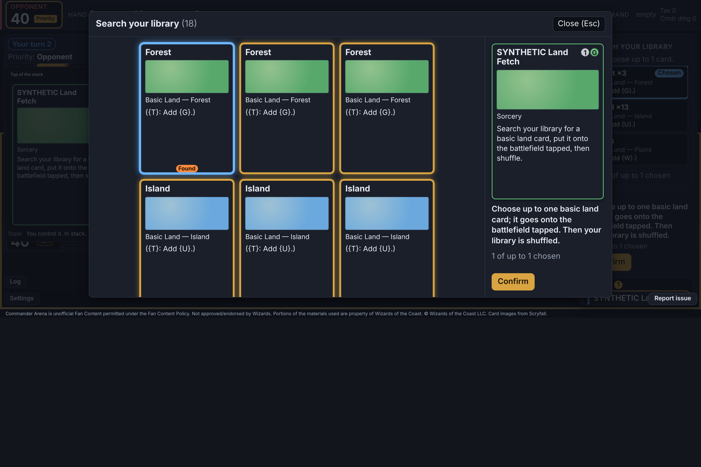
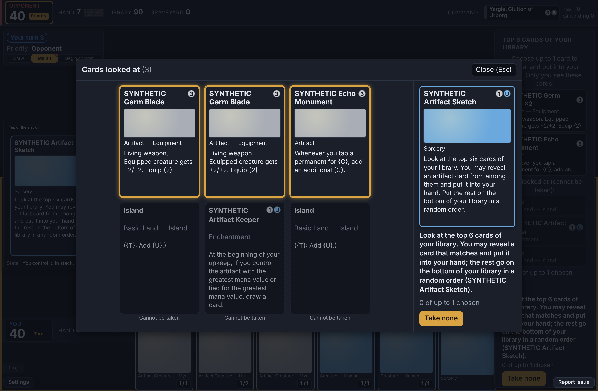

# Board components

Reusable pieces of the game screen, by name. Add a section when a component is shared by more than one decision.

## Zone Picker

A modal that lists the cards of one zone and, while the game asks the player a question about them, carries the whole question: the player reads, chooses and confirms in one place. Code: `apps/web/src/ui/board/ZoneViewer.tsx` (the component keeps its old file name), styles `.board-modal-*` and `.board-zone-card` in `board.css`, the question's data in `ui/decisions/zone-decision.ts`.

### What it shows

- **The list** (left): the cards of the zone as whole cards (200 px wide, the `full` card face), in a grid that scrolls inside the panel. A legal choice glows, a chosen one has a ring; a click chooses or takes it back. Hovering a card shows it in the preview panel, as everywhere else. Drag and drop of a card with flashback still works.
- **The question** (right, only while a targets or chooseCards question is pending): the card that asks (the spell or ability on the stack, drawn whole), the prompt ("Choose a target for ..."), the count ("0 of 1 chosen") and the buttons (Confirm, Cancel). They are the action bar's own model, so the dock and the picker always agree.
- **Close (Esc)** closes the list only, to look at the board; the question stays pending. While it is closed the dock's Confirm (and Enter) wait, and an "Open graveyard" button opens it again. A question can only be confirmed with the picker open (`ZoneGate` in `zone-decision.ts`, held by the decision layer).

Without a pending question (a player opens a graveyard, the exile or the command zone to read it) the picker is the list alone.

### When it opens

`Board.tsx` and `TableBoard.tsx` (three or more players) open it by themselves through `useQuestionZone` (`board/useQuestionZone.ts`; `questionZoneToOpen` in `board/target-zone.ts` decides) when:

- every legal target of a targets question is a card in one graveyard (#23); or
- the player searches their own library (a `chooseCards` question with purpose `search`): the list is the matching cards the engine shows the searcher, titled "Search your library". The library itself stays hidden; or
- the player looks at or reveals the top cards of their library and may take one (purpose `lookTake`, Hideaway and the like): the cards that can be taken are the list, and the others looked at follow as dimmed text cards marked "Cannot be taken" (their faces only, as the dock shows them). Titled "Cards looked at" or "Cards revealed"; or
- a `chooseCards` question picks cards in a graveyard or in exile (purposes `move`, `exile`, `additionalExile`: "return a creature card from your graveyard to your hand", "exile a card from your graveyard"): the legal cards are the list, titled "Choose from a graveyard" or "Choose from exile".

It closes by itself when the question is answered. The player can also open any zone from its button, and reopen the question's picker from the dock ("Open graveyard", "Open library").

### Where it is meant to be used

- Selections from a graveyard (targets, such as Meren of Clan Nel Toth's end step ability).
- Selections from a library by a search, and the top cards looked at (above). The dock's card list stays beside it, so both show the same choice.
- Not used: a question about the hand (a discard: the cards are already on the board) and the purposes that are not a plain pick (put on top, behold, separate into piles, free cast), which use the dock's list alone.

### Rules for changing it

- It reads the decision only through `useZoneDecision()`; it never builds its own prompt or buttons.
- Its buttons do not carry `data-dec-primary`: Space and Enter belong to the dock's button.
- Every choice goes through the interaction (`useInteraction`), so the engine's `applyAction` stays the only way to change state.
