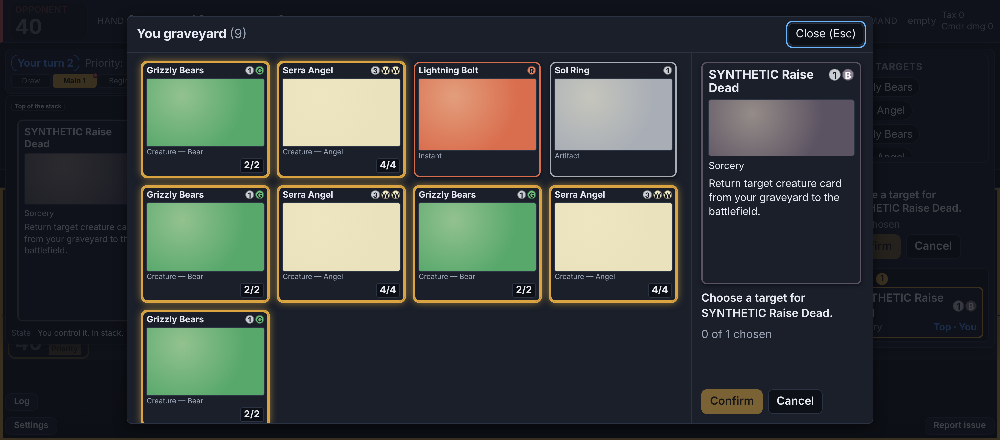

# Board components

Reusable pieces of the game screen, by name. Add a section when a component is shared by more than one decision.

## Zone Picker

A modal that lists the cards of one zone and, while the game asks the player a question about them, carries the whole question: the player reads, chooses and confirms in one place. Code: `apps/web/src/ui/board/ZoneViewer.tsx` (the component keeps its old file name), styles `.board-modal-*` and `.board-zone-card` in `board.css`, the question's data in `ui/decisions/zone-decision.ts`.

### What it shows

- **The list** (left): the cards of the zone as large cards (190 px wide), in a grid that scrolls inside the panel. A legal choice glows, a chosen one has a ring; a click chooses or takes it back. Hovering a card shows it in the preview panel, as everywhere else. Drag and drop of a card with flashback still works.
- **The question** (right, only while a targets or chooseCards question is pending): the card that asks (the spell or ability on the stack, drawn whole), the prompt ("Choose a target for ..."), the count ("0 of 1 chosen") and the buttons (Confirm, Cancel). They are the action bar's own model, so the dock and the picker always agree.
- **Close (Esc)** closes the list only; the question stays pending and is answered from the dock or by opening the zone again.

Without a pending question (a player opens a graveyard, the exile or the command zone to read it) the picker is the list alone.

### When it opens

`Board.tsx` opens it by itself when every legal target of a targets question is a card in one graveyard (`target-zone.ts`), and closes it when the question is answered. The player can also open any zone from its button.

### Where it is meant to be used

- Selections from a graveyard (today: targets, such as Meren of Clan Nel Toth's end step ability).
- Selections from a library (a search, "look at the top N"): the same list and the same question column, with the library's cards as the list. Not wired yet; `CardPickerPanel` still draws those in the dock.

### Rules for changing it

- It reads the decision only through `useZoneDecision()`; it never builds its own prompt or buttons.
- Its buttons do not carry `data-dec-primary`: Space and Enter belong to the dock's button.
- Every choice goes through the interaction (`useInteraction`), so the engine's `applyAction` stays the only way to change state.
