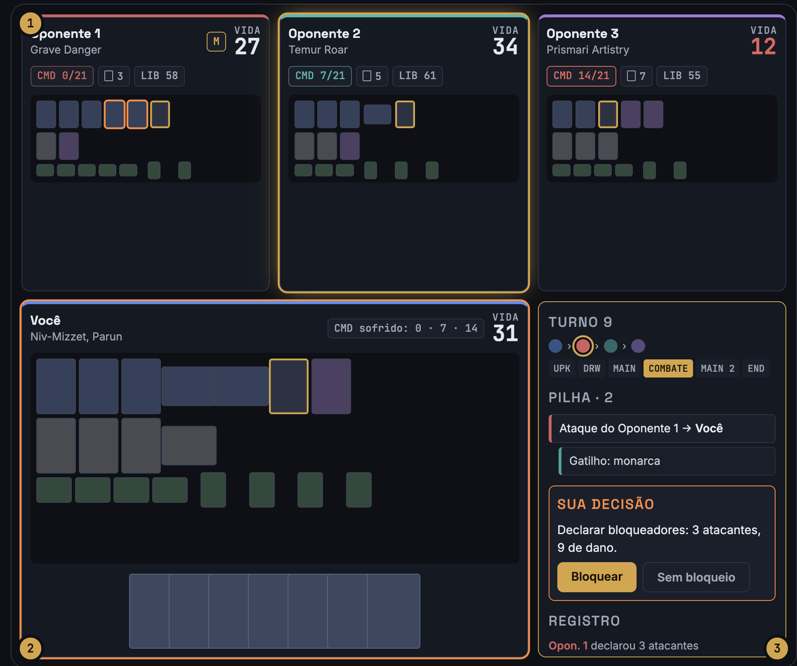

# Adding more opponents: investigation (3 and 4 seats)

Status: the engine, the cards, the AI, the host and a board of its own work with two to four seats, and the menu starts a game with one to three opponents (#540). What is left is in "What is left": an issue of the label in progress (#537), the soak (#585), reports from play, and decisions of the owner. Nothing here is a decision; the SPEC (section 2, "v2") only says that nothing in v1 may assume exactly two players. This note records what was read in the code and what the probes found, so the next step starts from facts. Counts and timings depend on the machine and the seeds listed below.

## Where we are

The engine (phase 1), the audit of the cards (phase 2), the AI fixes (phase 3) and the app (phase 4) are done, with what "What is left" lists. `createGame` takes two to four seats (#500) and `pnpm ai:arena --seats 3|4` plays tables (#502). The menu has a toggle for one to three opponents and a deck dialog for each (#519, #523) and starts the game (#540). The host runs one agent for each AI seat (#528) and ends the game when the human is eliminated, a decision of the owner (#529). The table screen shows a board of its own (#530, #532, #534, #541 to #545) with the opponents named by number (#536, #546), commander damage by source (#547), arrows of combat and of the stack (#549, #553) and an end screen for several opponents (#539). `e2e/table-game.e2e.ts` plays a four-player game from the `?autostart` URL with the AIs answering in turn. Performance with 3 and 4 seats is measured once, on a cloud machine (#533, "Performance with 3 and 4 seats"); the soak that plays tables in the nightly run is not started (#585).

Done: the N-seat harness (#362), the audit of the AI (#452; its fixes are #479 to #483), `ai:arena` for 3 and 4 seats (#482), leaving the game (#336, CR 800.4a; the `did not settle` crash is gone), the audit (#363), several defending players declaring blockers (#414), the battle protector chosen by its controller (#415), "choose an opponent" effects asking which one (#416), "an opponent has N life" ignoring players who left (#417), 3-seat tests of annihilator, reselecting an attack, "attacks you" triggers, goad, the random opponent, attack bans and commander damage (#421: all pass, no bug found), Myriad with 3 or 4 seats (#419), 3-seat scenarios for 26 real cards (#420: all pass; the list at the end got its first rows from the phase 2 audit), a battle whose protector left the game getting a new one (#432, CR 704.5y), #418 (a discard, an exile from a graveyard, a "may" or a search by several players collects every choice or answer first), the AI fixes #481 and #483 (their pull requests are #503 and #504; the casual agent's must-differ target slots are #501), a crash when a seat loses in the same check as its permanent dies (#475), the probe follow-ups (#453, see "Rerun on current main"), the latent single-opponent sites (#422), and the audit of about 380 more cards ("Phase 2 audit" below; its one failure was #506).

Open: #537 (the singular texts that are left, as of its last progress comment), #585 (the soak), what #553 left out of #538 and three reports from play on the table board (#560, #566, #580), all in "What is left". The three rulings of the audit are all settled: #507 (a goad that never ended when its goader left the game) by CR 800.4m (#522), #508 (Mindblade Render with two opponents hit in one combat) by the official ruling of the card (#524) and #509 (Tasigur asked the first opponent only) by #520.

Not audited: the view code beyond what the board steps read. The probe tables of the first sections are from before #414 to #418; "Rerun on current main" is the latest.

## Question

Can the app run free-for-all Commander games with 3 and 4 seats, what would break, and what does the board look like?

## What the code already does

- `SeatId` is a `number` and `GameState.seats` is an ordered array. The SPEC forbids `players[1]`; no `seat ^ 1` or `1 - seat` pattern was found in the rules code.
- The next turn goes to the next seat that has not lost (`startNextTurn` in `rules/flow.ts` through `seatsInOrder` in `state/ops.ts`, which skips seats with `hasLost`). The skipped first draw (CR 103.8a) applies only with two seats. The free first mulligan (CR 103.5c) is forced on for more than two seats, and the order of the mulligans uses `seats.length` (`rules/setup.ts`).
- `apnapOrder` (`rules/select.ts`) orders `eachPlayer` and `eachOpponent` effects. `loseTheGame` (`rules/lose-game.ts`) marks `hasLost` per seat, and the monarch moves on when its holder loses.
- `commanderDamage` is keyed by the damaged seat and the commander card (`commanderDamageKey` in `rules/sba.ts`, `"seat:card"`), so it can hold several defenders. That the 21-point loss is checked per key with more than two seats was not read.

## What is left

Nothing blocks a game any more: the host, the menu and the board are built (see "Where we are"). What is left, from the issues, the pull requests and the code:

- Texts: #537 is in progress. After #546 it still lists the `targetLabel` of `ui/decisions/TargetsPanel.tsx` (every other seat says "Opponent"), the rows of the attack target dialog, and the long strings of `game/` that name a seat as "the opponent" (the monarch and Korvold text modules). #566 (choosing an opponent names the seat) is probably the same `targetLabel`.
- Combat on the table board: #549 closed #538, but #553 says that combat order, pair focus and combat effects with attackers against two defenders, and the viewer's wait while an AI seat blocks first, are not covered. No open issue has them.
- Reports from play, with no work yet: #560 (the creature tiles are too big on the table board), #580 (the battlefield cannot be seen entirely nor scrolled to its edges; #541 removed the scroll buttons of the table board, and the rows still scroll with the wheel, the trackpad or touch, which may be the cause) and #566.
- The soak: #585. The only soak that plays real precons plays two seats.
- Performance: measured once, on a cloud machine. The numbers of the owner's machine and the limit the app accepts (a decision of the owner, below) are open.
- Rules not built (`docs/RULES_COVERAGE.md`, `docs/ROADMAP.md`): CR 800.4c, 800.4e to 800.4i and 800.4k, 806, effects that last until a point of the next turn of a player who left (`turnEnd`, `endStep`), and the active seat of a turn in which its player left (CR 800.4j: the engine passes the priority on, but the seat stays active until the turn ends). The range of influence (CR 801) is an owner decision (below).
- Later adjustments of the board: see "Later adjustments".

## Probe

The first runs below came from a local patch; the probe is in the repository now (`tools/ai/multiplayer-probe.ts`, #371), `createGame` takes two to four seats (#500) and `runGame` takes any number of agents. It played whole games of the real precons (`apps/web/src/precons/snapshots/`), one agent per seat, through `runGame`, with three changes: `createGame` accepted two to four seats, `runGame` took any number of agents instead of a pair, and each agent was wrapped to record what its view shows about seats that have lost (`node tools/ai/multiplayer-probe.ts --players 3|4 --games N --agent random|casual|greedy|heuristic [--seed S] [--verbose]`).

First run: agent `random`, 10 games per seat count, first seed 1, 100 turns and 8000 actions as limits.

| | 3 seats | 4 seats |
| --- | --- | --- |
| Games ending with a winner | 10 of 10 | 6 of 10 |
| Stopped at the turn cap | 0 | 3 |
| Engine crash | 0 | 1 (`State-based actions and triggers did not settle`) |
| Actions the engine rejected | 0 | 0 |
| Average final turn | 75 | 96 |

Anomalies seen in the views of the agents (decisions in which each appeared):

| Anomaly | 3 seats | 4 seats |
| --- | --- | --- |
| A permanent stays on the battlefield under a player who has lost (CR 800.4a) | 4500 | 4629 |
| The active seat is a player who has lost (not examined: it may be a player who lost during their own turn) | 17 | 54 |
| A seat that has lost was asked for a decision | 1 | 3 |
| A stack object is controlled by a player who has lost | 2 | 0 |

Second run: agent `casual`, 10 games per seat count, first seed 1, same limits.

| | 3 seats | 4 seats |
| --- | --- | --- |
| Games ending with a winner | 7 of 10 | 7 of 10 |
| Engine crash (`State-based actions and triggers did not settle`) | 3 (seeds 2, 5, 9) | 3 (seeds 4, 6, 9) |
| Actions the engine rejected | 2 (`You cannot pay that cost`) | 0 |
| Average final turn | 38 | 45 |
| First loss seen at turn | 23 to 42 | 19 to 56 |

The same anomalies as in the first run appeared (permanents under a player who has lost: 1940 decisions with 3 seats, 5226 with 4; the active seat a player who has lost: 28 with 4 seats and none with 3; stack objects of a player who has lost: 10 with 4 seats). The casual agent eliminates players much earlier than the random one, and the crash is far more frequent: 6 of 20 games. It is not known yet whether the crash is specific to more than two seats; the same seeds were not played with two.

Third run: agent `heuristic` (the strongest agent of `packages/ai`), 10 games per seat count, first seed 1, same limits.

| | 3 seats | 4 seats |
| --- | --- | --- |
| Games ending with a winner | 8 of 10 | 9 of 10 |
| Engine crash (`State-based actions and triggers did not settle`) | 2 (seeds 1, 7) | 1 (seed 7) |
| Actions the engine rejected | 5 | 1 |
| Fallbacks recorded by the agent | 2 | 3 |
| Average final turn | 31 | 43 |
| First loss seen at turn | 16 to 39 | 21 to 40 |

The rejections the probe sampled (up to two per game) were `You cannot pay that cost` and, with 3 seats, a mana ability tried with a pool that lacked the {1} (Overflowing Basin). The same leaving-the-game anomaly appeared: permanents under a player who has lost in 1862 decisions with 3 seats and 6115 with 4; a seat that has lost was asked for a decision 3 and 6 times; the active seat a player who has lost twice with 4 seats. With a stronger agent the games end sooner and fewer crash (3 of 20), but a crash in every run, with every agent, means it is not specific to one agent. The cause is below.

## Cause of the `did not settle` crash

Reproduced with seed 7, 3 seats, agent `heuristic` (decks, in seat order: Grave Danger, Prismari Artistry, Temur Roar), by adding to the error of `settle` (`rules/settle.ts`) the last events and the waiting triggers. At the crash seat 0 had lost (`hasLost`) and it was seat 2's declare attackers step. One triggered ability was waiting: the "attacks the enchanted player" trigger of a permanent controlled by seat 0 (`controller: 0`, an Aura of Grave Danger that enchants a player).

`putTriggersOnStack` (`rules/trigger-stack.ts`) walks `seatsInOrder`, which skips seats that have lost, so no seat ever puts that trigger on the stack and nothing removes it. `settle` then repeats a round that changes nothing until its guard of 10,000 rounds throws. The loop produced no events.

CR 800.4d says it outright: "If a triggered ability that would be controlled by a player who has left the game would be put onto the stack, it isn't put on the stack." The engine neither drops such a trigger nor lets it wait harmlessly. So the crash comes from the same gap as the permanents that stay after their owner loses (CR 800.4a): the triggers, and the objects, of a player who left the game are not removed. It needs more than two seats by its mechanism: with two seats the game ends when a player loses, so no trigger of a player who has lost can be waiting. The same three decks with seats 0 and 1 only (a different game, since the shuffles differ) ended at turn 18 with a win and no crash. The other seven crash seeds of the casual and heuristic runs were played again with the same extended error, and all end the same way: at the crash every waiting trigger belongs to a seat that has lost.

| Run | Waiting triggers (kind) | Controller | Seats that have lost |
| --- | --- | --- | --- |
| heuristic, 3 seats, seed 1 | cast a spell | seat 1 | seat 1 |
| casual, 3 seats, seed 2 | leaves the battlefield | seat 1 | seat 1 |
| casual, 3 seats, seed 5 | attack batch | seat 1 | seat 1 |
| casual, 3 seats, seed 9 | dies, leaves the battlefield | seat 0 | seat 0 |
| casual, 4 seats, seed 4 | dies | seat 1 | seat 1 |
| casual, 4 seats, seed 6 | attack batch, attacks | seat 2 | seats 0 and 2 |
| casual, 4 seats, seed 9 | dies, leaves the battlefield (twice) | seat 0 | seat 0 |

The crash seeds of the random run were not examined. A game is reproduced from its seed and seat count alone, so the wrapper of the probe is not needed to replay it.

## Reading of the results

- The engine plays games with more opponents to the end in most games: it is closer than the docs suggested. That does not prove the rules right.
- A player who loses is not removed from the game: their permanents stay on the battlefield, and objects they control were seen on the stack. The next turn does skip a seat that has lost (`seatsInOrder`), so the lost seat seen as the active seat is a player who lost during their own turn. CR 800.4j says that turn goes on to its end without an active player and that the next player in turn order receives the priority the active player would have had; the engine keeps the seat as the active one, which is a difference to check, not yet a known defect. A lost seat that was asked for a decision is also unexplained. The crash is traced to the same gap (above). The turn caps of the random run are not explained.
- With the random agent the first losses appeared late (turn 41 to 94), so it exercises the leaving-the-game paths little; the casual agent does it earlier (turn 19 to 56).

## Rerun after leaving the game (step 2)

Step 1 (#371) put the probe in the repository and step 2 (#377, CR 800.4a) made a player who loses leave a game that goes on. The three runs were played again with `node tools/ai/multiplayer-probe.ts --players 3|4 --games 10 --agent random|casual|heuristic --precons`, seed 1, 100 turns and 8000 actions as limits.

| Agent, seats | Games ending with a winner | Engine crash | Rejected actions | Average final turn |
| --- | --- | --- | --- | --- |
| random, 3 | 9 of 10 (seed 8 at the turn cap) | 0 | 0 | 68 |
| random, 4 | 7 of 10 (seeds 1, 7, 9 at the turn cap) | 0 | 0 | 89 |
| casual, 3 | 10 of 10 | 0 | 0 | 30 |
| casual, 4 | 10 of 10 | 0 | 0 | 46 |
| heuristic, 3 | 10 of 10 | 0 | 0 | 28 |
| heuristic, 4 | 10 of 10 | 0 | 0 | 44 |

In all six runs no permanent stayed under a player who had lost, no seat that had lost was asked for a decision and no stack object was controlled by one. The crash is gone (9 of 60 games before, 0 now) and so are the rejected actions, which were probably a result of the broken state. The lost seat as the active seat still appears (random 30 and 42 decisions with 3 and 4 seats, heuristic 24 with 4 seats): a player who leaves on their own turn stays the active seat until it ends and is asked nothing, the smaller option of point 3 of #336. The four games at the turn cap are all with the random agent; seed 8 with 3 seats is new. None of the four was examined at the time; the next section did.

## Rerun on current main (#453)

`node tools/ai/multiplayer-probe.ts --precons --games 10 --agent random|casual|heuristic` on `main` after the AI fixes. The seed-to-deck pairing differs from the first runs, so the old seeds cannot be replayed.

- Turn caps: with the random agent 6 of 10 games with 4 seats reach the 100-turn cap (seeds 2, 3, 4, 5, 7, 10) and none with 3 seats; with 2 seats the same agent leaves 1 of 20 unfinished. At the cap the games are not stalled (4000 to 5000 of 8000 actions used, libraries still at 38 to 67 cards, life totals spread out, some seats already lost): a weak agent, since random seats rarely attack well and more seats mean more life to remove. Not an engine defect.
- Rejected actions: none with the random agent, and none with casual or heuristic with 3 or 4 seats (10 of 10 games won). The two `You cannot pay that cost` rejections and the Overflowing Basin one did not recur, so they were a result of the broken state before #377. One new rejection of the casual agent with 4 seats (`Choose 1 to 1 targets for t2`, Incremental Blight) was fixed by #501.
- Seats that have lost: no permanent under them, no decision asked of them, no stack object controlled by them. The only counter left is the active seat that left on its own turn (CR 800.4j), which showed in 2 decisions of one game and changed no outcome. The engine now passes the priority to the next seat when the seat that left held it (`api.ts`, `leave-game.test.ts`); the seat stays active until the turn ends, a limit listed in ROADMAP.

## Limits of this probe

- All three agents were run at 10 games per seat count, which is a small sample: the crash rates (1 to 3 of 10) are not comparable between agents. Decision time was not measured.
- The crash seeds are recorded above; eight were reproduced, not with `replayGame` but by running the same seed again with the error of `settle` extended (a scratch change, not kept). The three turn caps of the random run were not recorded.
- The fallback count of the wrapper is fixed at construction and under-counts; it is zero for the random agent anyway.
- Decision times were not measured. Runs of 10 games took on the order of minutes.
- The probe's agents are wrapped, so a failing seed must be replayed without the wrapper to confirm it.

## Remaining risks, in order of weight

1. Tests: no soak plays tables of three or four seats (#585), so the paths that only a table uses (leaving the game, several defenders, the host for each AI seat) are checked by scenarios and a few e2e tests and not by the nightly run; and the scenarios of the phase 2 audit were not kept (a card of the corpus is not guaranteed to have its own 3-seat test).
2. Performance: more permanents and triggers; measured once on a cloud machine only. The owner's numbers are the ones that count, and the limit is not decided.
3. UI: combat order and pair focus with two defenders are untested, three reports from play are open (#560, #566, #580), and phone width is left out of the board plan.
4. Rules: the CR sections listed under "What is left", and cards that were checked only with the text the parser reads (the audit says which were read and not run).

## Board plan: a separate board for three or more players (phase 4)

The board for three or more players (two or more opponents) starts as a board of its own, next to today's. The first pull requests left the current board (`Board.tsx`, the screen of `Game` in `App.tsx`) as it is for 1v1; later ones changed parts both boards share (for example #544, "on both boards", and #574, which repaired the browser tests a board redesign broke). The app already has a separate screen for a table (`screen === 'table'`, `EmptyTable` in `App.tsx`, #523), so the new board goes there and `Game` is left alone. The new board composes the components that exist (`Field`, `PlayerStrip`, `HandBacks`, the turn box, the stack, the decision dock) and does not edit them where it can avoid it. Whether the two boards become one is a later decision, after the new one works. The screen is a grid:

```
3 opponents                 2 opponents                 1 opponent
| opp 1 | opp 2 | opp 3 |   | opp 1     | opp 2     |   today's board,
| you           | flow  |   | you           | flow  |   not touched
```

Opponents share the top row equally. You get the bottom left (4 of 6 columns). The flow cell (2 of 6) holds what floats today at the right edge and top left: the decision dock, the stack and the turn box. The template is a pure function of the opponent count (`tableAreas`, unit tested like `layout.ts`), so adding a seat count adds a row to a table, not a component.

### The mockup (owner, three opponents)



The mockup is about where the players sit, not a design of the strips. It fixes:

- The opponents share the top row in equal columns, one cell each (zone 1), up to three.
- You are at the bottom left, about two thirds of the bottom row, with your hand under your battlefield (zone 2).
- The flow cell is at the bottom right, the rest of the bottom row (zone 3): the turn, the stack and your decision.
- The log, the settings and "Report issue" stay at the bottom left as in 1v1 (`LogDock`, `SettingsDock` and `ReportDock` in `App.tsx`, outside the board). The flow cell has no log.

Everything else in the picture (the colour of each seat, the chips, the wheel of seats, the compact strip, the highlighted borders and the Portuguese labels) is illustrative and not a requirement. The first version reuses today's components and they are adjusted afterwards ("Later adjustments").

### What is reused as it is

By composition: the new board imports these and does not change them.

| Today | In the new board |
| --- | --- |
| `Field` and `BattlefieldRow` | One per seat, unchanged. Rows measure their own cell (`useMeasure`) and pick tile height, grouping and scrolling from it, so a narrower cell is not a new code path. `ROW_ORDER_OPP` already mirrors the opponent. |
| `PlayerStrip` and its parts (`CommandBox`, `ManaPool`, `CommanderChip`, `LibraryTop`) | Unchanged at first, one for each seat. A compact density is added only if the strip does not fit its cell (decided with the screenshots of step 2). |
| `HandBacks` | One per opponent. |
| `BlockArrows`, `StackArrows` | Measure tiles from the DOM by `data-object-id` (`panels/arrows.ts`), so they do not care where a cell is. To confirm with a test at 3 opponents. |
| `DecisionLayer`, `DockSlotContext`, `StackPanel` | In `Game` the dock slot is in `aside.turn-panel`; the new board gives the same slot to its flow cell. |
| `ix.clickableSeats`, `ix.onSeat`, `AttackTargetDialog` | Already keyed by seat id and by `player:<seat>` options. They only need names. |
| `TurnTracker` | It floats at the top left in `Game`; in the new board it sits in the flow cell, as it is. A turn-order wheel is a later adjustment. |
| `LogDock`, `SettingsDock`, `ReportDock` | Unchanged and outside the board: the bottom left, as in 1v1. The flow cell has no log. |

### What had to change in the first version

These were about being correct with several opponents, not about looks. All are done except what #537 still lists.

- `seatLabel` said "Opponent" for everyone. The table board numbers the opponents ("Opponent 2": #536, #546); the two copies of `seatLabel` (`ui/board/resolve.ts` and `ui/decisions/lookup.ts`) and the remaining strings are #537.
- `commanderDamageTaken` named the source only when there was one source. `GameView.commanderDamageSources` maps each `"seat:card"` key to its owner and the chip reads "from Opponent 1" with three or more seats (#547).
- Words that say "the opponent" in the singular and are shared by both screens: `game-over-model.ts` (who won, with three opponents) is done (#539), the log and the loose texts are #546, the rest is #537. The 1v1 text is unchanged, and the tests of the 1v1 strings stay.
- A seat that left the game is taken off the board and the others share the top row; the numbers of the opponents do not change (#542). What it owned has left the game (CR 800.4a).
- New rules are in `table.css`, with class names of their own (`table-`).
- The host and the table screen starting a game are #528, #529 and #540.

### Later adjustments

Done on the way: a strip of one row with a 2x2 of counts (#545), commander damage on the strip (#547), and the opponent who lost leaving the board (#542). Not planned as pull requests; each becomes an issue when wanted: merging the two boards into one, a colour for each seat, the turn-order wheel in the flow cell, widening the column of the seat that attacks or targets you (UI state, never engine state), opponents stacked below about 1100 px wide, and phone width.

### Developing it

The board was developed from synthetic `GameView` fixtures before the host existed (`e2e/table-board.e2e.ts` keeps them); since #540 `e2e/table-game.e2e.ts` plays a four-player game from the `?autostart` URL.

### Steps

All five are merged.

1. Pure parts: `tableAreas` and the label that numbers the opponents (#530).
2. `TableBoard` (`ui/board/TableBoard.tsx`, `table.css`) with the existing components (#532), and then details on the table board: no scroll buttons, a smaller hand and a narrower flow cell (#541), the opponent who lost off the board (#542), the commander popup (#543, #544) and a strip of one row (#545).
3. The flow cell (#534).
4. What must be right with several opponents: the numbered names (#536, #546), commander damage by source (#547), arrows of combat and of the stack (#549, #553) and the end screen (#539). What is left of it is in "What is left".
5. The table screen shows `TableBoard`, the menu starts the game with the host and a four-player game is played in an e2e (#540).

### Open choices

- When, if ever, the two boards become one (not before the new board works).
- The narrowest window width the board must support.

## How games would be run

1. Probe: `runGame` with one agent per seat, as above (headless, deterministic, seeds reproduce; `tools/ai/multiplayer-probe.ts`). Done.
2. Arena (`pnpm ai:arena`): two seats play paired seeds with swapped sides; `--seats 3|4 --agents ...` plays a table with the agents rotated through the seats (#482; arena decks only). Done.
3. App: the host keeps one agent per AI seat and runs the ones with a pending decision in turn; the menu chooses the seat count and a deck for each. The menu, the host and the table screen are built (#519, #523, #526, #540).
4. Tests: a scenario DSL that accepts 3 and 4 seats and the rule scenarios written first are done (#362, phase 2); the benchmark with a seat count is `derive-bench --seats` (#533); a nightly soak that plays tables is not built (#585).

## Plan in phases

0. Investigation (this note): done.
1. Engine: leaving the game, a player who loses during their own turn (priority only), several defenders, APNAP, commander damage with several defenders: done (#336, #414 to #419, #432), with the rules of "What is left" left out.
2. Cards: the supported cards that depend on the number of opponents were re-tested with 3 and 4 seats (#420, "Phase 2 audit"): done; the table of cards not supported for several opponents is empty.
3. AI: a target policy, lethal checks, defenses and several hidden-hand samples (#452 and its fixes), `ai:arena` with 3 and 4 seats (#482), and its decision time (#533): done.
4. UI: the board plan (#499), the host, the menu flow, the table board, the end screen and the arrows (#528 to #549, #553): done, except what "What is left" lists.
5. Performance, soak and the release in the menu: the release is done (#540, one to three opponents in the menu); performance is measured once (#533); the soak is open (#585).

## Decisions that are the owner's

- Decided: when the human is eliminated the game ends, as in a 1v1 (#529).
- What share of decisions over the 5 s budget and what wait per round of AI turns the app accepts with 3 and 4 seats (see "Performance with 3 and 4 seats"; in the one run no decision went over the budget).
- The range of influence (CR 801): off, so that everyone is in range?
- Whether `docs/SPEC.md` section 2 (the "v2" line, 2 to 6 seats) changes: the engine takes two to four (needs approval).

## Open work from the probe

- The turn caps of the random run, the rejected actions and the views of seats that have lost: answered in "Rerun on current main" (#453); the active seat that left (CR 800.4j) stays a limit in ROADMAP.
- The 21-point commander loss with several defenders: the key `"seat:card"` is per defender in `lossReasons` (CR 903.10a, 104.3j) and 3-seat tests cover it (#421).
- The AI for 3 and 4 seats: audited in #452; the fixes are #479 to #483, #501, #503 and #504.
- Inventory of `'opponent'`: done for the rules; the parser is left as card-pipeline limits (see "Audit of the one-opponent assumptions").
- The scenario DSL plays 3 and 4 seats (`scenario({ seats })`), with limits seen in the phase 2 audit: `expect.canBlock` and the default attack target throw with more than two seats (`testing/expect-combat.ts`, `testing/combat-refs.ts`), `concede()` works only while that seat holds the decision, and a second concede with the default invariant check fails with "card cN has 0 objects".

## Audit of the one-opponent assumptions (step 3, #363)

Read-only audit of `packages/engine/src/rules/`. The selector layer is already correct for N seats (`resolvePlayers` returns every living opponent in turn order, and sacrifice, clash, vote, control changes, gift, encore, crime, speed, the Ring and the monarch handle N). What is wrong with 3 or 4 seats, and the issue that fixes it:

| Finding | Where | Issue |
| --- | --- | --- |
| Latent `resolvePlayers(...)[0]` and `[0]` sites, none reachable from real card text | `amounts.ts`, `effects.ts`, `legality.ts`, `control-effects.ts` | #422 |

A battle's protector is now chosen by its controller among their living opponents (CR 310.9a, 310.12a; #415), and so is the opponent in "an opponent separates, chooses or copies" (Demonstrate, piles, Coin of Fate; #416, CR 608.2d, 801.5b), each asked only with more than one. "An opponent has N or less life" now ignores opponents who left the game (CR 800.4a; #417).

The combat data model already supports several defenders (each attacker stores its own target and defender, and `defending.ts` derives the defending player per creature, CR 508.5a); the defending players now declare blockers one after the other, each against the attackers aimed at them (CR 802.4; #414). Tests for annihilator, `reselectAttack`, goad and commander damage with 3 seats: #421. The AI was audited afterwards (next section); the UI and the view code were not.

## Audit of the AI (phase 3, #452)

About 40 places in `packages/ai/src` look up another seat. Wrong with several opponents (fix issue): the attack target is always the lowest-numbered living opponent and a lethal attack on another is missed, reproduced with the casual, greedy and heuristic agents (#479); the lethal checks mix the life of the weakest opponent with the poison and commander damage of the first (#480); player-targeted spells go to the first opponent (#481); the crack-back penalty and the block model assume one opponent (#483). The same with N: `evaluate`, `simAction`/`playOut`, `determinize` (it redeals the hidden cards of every other seat; `packages/ai/test/determinize-three-seats.test.ts`) and the answers of the vote, Ring, search and pile decisions. Its decision time with more permanents was measured afterwards (#533, "Performance with 3 and 4 seats").

## Phase 2 audit: the cards with 3 and 4 seats

The inventory ran the parser over the golden corpus and the precon snapshots (2,210 distinct cards, 2,169 supported). 483 supported cards have text that reads opponents or players (opponent, each player, monarch, vote, goad, myriad and similar); 104 were already in a 3-seat test, and the other 379 were grouped by the engine primitive they depend on and played with 3 and 4 seats, with a 1v1 control. Support is proven per primitive, so each group has one scenario per primitive and names the cards it stands for.

Result: one failure and three rulings, all settled since (#507, #508, #509).

- Failure, fixed (#506, #510): "each other opponent" also damaged the opponent the event was about, because `readsTriggerPlayer` did not know `eachOtherOpponent`. It happened with two seats as well.
- Needs a ruling (#507, #508, #509): the CR text was not available in the audit, so every rule number in it was UNVERIFIED. #507 was settled afterwards with the text of CR 800.4m (an effect that lasts until the next turn of a player who left lasts until that turn would have begun); #508 with the official rulings of Mindblade Render (Scryfall, source wotc, 2018-06-08), which the CR does not decide; #509 was fixed in #520.
- Passed: monarch, goad by Aura and by spell, "defending player", "target opponent" with two opponents, "for each opponent", opponent counts, each-opponent drain and damage, APNAP order of sacrifices, discards and "may" choices, tempting offers, gifts, myriad, encore, annihilator, emblems, and the opponents who left the game.
- Limits: part of the cards of each group were not in the corpus and ran with SYNTHETIC cost and power or toughness; a primitive that was read but not run (for instance a card whose text only repeats a tested primitive) counts as covered by reading, not by a test. The per-primitive notes and the scratch tests were not kept in the repository, so a card of the corpus is not guaranteed to have its own test.

## Performance with 3 and 4 seats (#527)

Measured, not optimised. Machine of this run: a cloud container, 4 cores, Intel Xeon 2.1 GHz, Node 22.23, Linux x86_64. **The numbers that count are the ones the owner runs on their own machine**; these are indicative, and the samples are small (2 to 4 seeds for the arena, 12 for `derive-bench`). Same real precons for every seat count (`apps/web/src/precons/snapshots/`).

Commands (seed 1, real clock, one agent kind at every seat, decks stay with the seat when the agents rotate):

- Two seats: `node tools/ai/arena.ts --a <kind> --b <kind> --games 6 --seed 1 --precons --pairing cross --real-clock --max-turns 200 --max-actions 20000`
- Three: `node tools/ai/arena.ts --seats 3 --agents <kind> --games 6 --seed 1 --precons --real-clock --max-turns 300 --max-actions 30000`
- Four: the same with `--seats 4 --games 8 --max-turns 400 --max-actions 40000`.
- Engine: `node tools/perf/derive-bench.ts --seats <n> --seeds 12 --reps 15 --max-turn 20 --keep 4`

AI decisions (every game finished, no fallback, no rejected action, none over the 5 s budget):

| Agent, seats | Decisions | Mean | 95th percentile | Slowest | Per turn | Per round of turns |
| --- | --- | --- | --- | --- | --- | --- |
| casual, 2 | 2707 | 0.06 ms | 0.1 ms | 2.2 ms | 25.5 decisions, 1.5 ms | 51.1 decisions, 2.9 ms |
| casual, 3 | 8812 | 0.04 ms | 0.1 ms | 2.1 ms | 38.3 decisions, 1.6 ms | 114.9 decisions, 4.8 ms |
| casual, 4 | 17838 | 0.04 ms | 0.1 ms | 3.0 ms | 46.0 decisions, 1.9 ms | 183.9 decisions, 7.7 ms |
| heuristic, 2 | 2612 | 2.92 ms | 18.5 ms | 148.9 ms | 25.6 decisions, 74.8 ms | 51.2 decisions, 149.5 ms |
| heuristic, 3 | 8457 | 4.70 ms | 24.8 ms | 480.1 ms | 38.6 decisions, 181.7 ms | 115.8 decisions, 545.0 ms |
| heuristic, 4 | 16472 | 5.08 ms | 19.0 ms | 1378.4 ms | 48.4 decisions, 246.0 ms | 193.8 decisions, 984.1 ms |

A turn is the engine's turn counter and a round is one turn of every seat, so "per round" is the wait when every seat is an AI; with one human it is the round minus the human's turn. The heuristic agent is the slow one: its slowest decision grows with the seats (149 ms, 480 ms, 1378 ms) but stays well under the budget here.

Engine, biggest boards of 12 casual games at turn 20 (precons played by `derive-bench`):

| Seats | Permanents (kept) | `getView` first call | `getLegalActions` | `applyAction` (first 5 legal actions) | Whole turn of the biggest board | View size at the biggest boards |
| --- | --- | --- | --- | --- | --- | --- |
| 2 | 32, 31, 30, 30 | 1.3 to 2.9 ms | 0.01 to 0.02 ms | 2.2 to 3.4 ms mean, 12.3 ms p99 at most | 73.6 ms (34 actions) | 24.1 to 30.1 KB |
| 3 | 53, 49, 37, 37 | 1.6 to 2.4 ms | 0.01 to 0.03 ms | 3.1 to 13.3 ms mean, 60.5 ms p99 at most | 393.5 ms (135 actions; combat steps 282.9 ms) | 26.5 to 45.6 KB |
| 4 | 40, 36, 35, 35 | 1.5 to 2.0 ms | 0.01 to 0.02 ms | 2.7 to 9.4 ms mean, 102.1 ms p99 at most | 119.9 ms (53 actions) | 25.0 to 48.0 KB |

What it says, and what it does not:

- The engine is cheap per call at every seat count. The slowest `applyAction` seen was 102 ms (among the first five legal actions of a 40-permanent, 4-seat state); along the biggest turn it was 68 ms (the 53-permanent, 3-seat board), and that whole turn took 393 ms in the engine.
- The view grows from about 30 KB to about 48 KB at the biggest boards, not with the seat count by itself but with the permanents on the table.
- Not measured: the human-facing wait with a heuristic opponent at four seats on a slower machine, tables with different agents, and decks other than the five committed precons. The boards come from casual agents, which build the biggest boards; the decision-time rows come from tables of one agent kind.
- Games between identical agents with decks tied to the seats are won mostly by the same seat (the deck, not the agent), so these tables say nothing about strength.

**Decision for the owner:** what share of decisions over budget and what wait per round of AI turns the app accepts for 3 and 4 seats. In this run no decision went over the 5 s budget; the heuristic agent's round of AI turns is about 0.5 s with three seats and about 1 s with four. Each hot spot (for example the combat steps of big boards, or fewer samples for each heuristic decision when there are more opponents) would be its own issue.

## Cards not supported for more than one opponent

Support is one flag per card today, so a card here is marked supported in the golden corpus and is known not to work with 3 or 4 seats. 1v1 support is unchanged. Add a card with what fails and the issue that fixes it; delete the row when the fix is merged. The 3-seat re-test that fills this list is #420.

| Card | What fails with 3 or more seats | Issue |
| --- | --- | --- |
